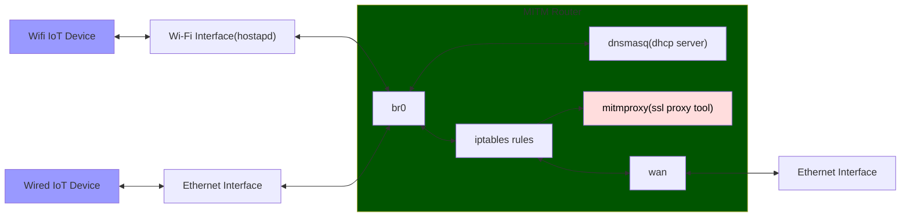

# mitmrouter
Bash script to automate setup of Linux router useful for IoT device traffic analysis and SSL mitm




## Dependencies

- hostapd
- dnsmasq
- iproute2
    - provides `ip` (preinstalled on every modern Linux distro)
- nftables
    - provides `nft` (preinstalled on most modern Linux distros)

## Usage

You may want to disable NetworkManager as it may fight for control of one or more of the network interfaces.

Before running the script, copy `mitmrouter.conf.example` to `mitmrouter.conf` and edit it to set your interface names, Wi-Fi SSID, password, and other details. If `mitmrouter.conf` is missing on first run, the script will auto-create it from the example and exit so you can edit it.

`LAN_ENABLED` and `WIFI_ENABLED` (both default `"1"`) control whether the wired LAN interface and the Wi-Fi AP are brought into the bridge. Set either to `"0"` to run a Wi-Fi-only or wired-only LAN. At least one must be enabled — the script will refuse to start if both are `"0"`. When `WIFI_ENABLED="0"`, hostapd is not started and the corresponding interface name (`WIFI_IFACE`) is ignored; same for `LAN_ENABLED="0"` and `LAN_IFACE`.

```
./mitmrouter.sh <up|down|refresh>
```

The `./mitmrouter.sh up` command will bring down all the linux router components and then build them back up again

The `./mitmrouter.sh down` command will bring down all the linux router components

The `./mitmrouter.sh refresh` command regenerates the dnsmasq and hostapd configs from `mitmrouter.conf` and re-applies iptables rules without tearing down or re-creating the bridge and interfaces. Useful when you edit `mitmrouter.conf` and want to apply changes (e.g. new MITM redirect rules) without rebuilding the router from scratch. Wi-Fi clients will re-associate because hostapd restarts, but the bridge stays up.


